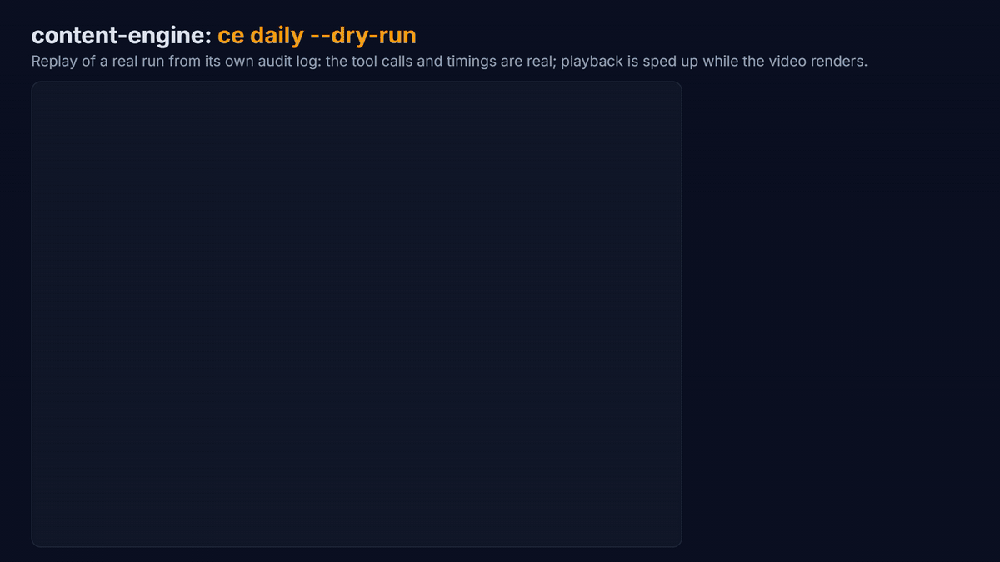
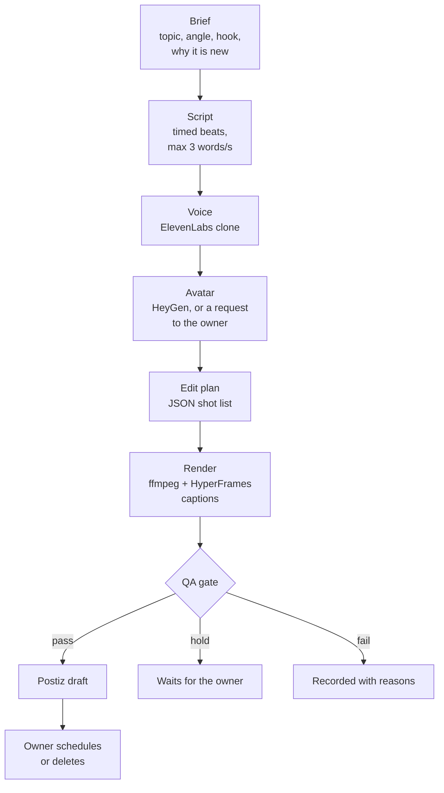
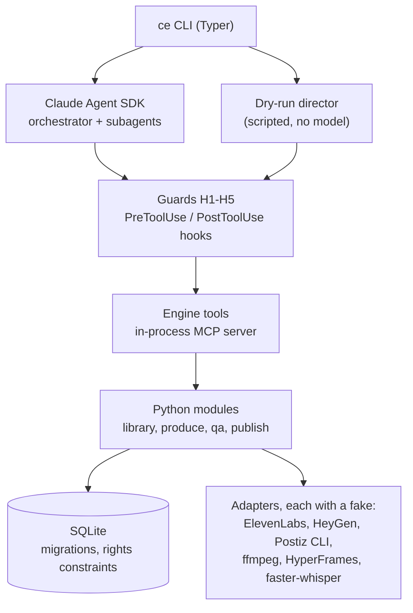

# content-engine

A local Python system that plans, scripts, voices, edits and drafts short vertical videos for niche *identities*, under rules a human sets. Claude makes the judgment calls (the brief, the script, the edit plan, the QA review). Python does everything mechanical and owns every side effect, behind guards the model cannot talk its way past. A person approves every post before it goes out.



*A replay of a real `ce daily --dry-run` on the build machine, from the run's own audit log (timings real, the render sped up). Every vendor is faked, so the presenter is a placeholder card and the B-roll is drawn by ffmpeg. [MP4](docs/media/demo.mp4).*

> **Status:** Phase 0. The whole pipeline runs end to end on fakes: brief, script, voice, avatar, edit plan, render, captions, QA gate, Postiz draft. The live slices (real voice clone, real avatar, the first published Short) wait on accounts and keys.

## What a post goes through



- **The edit plan is data, not pixels.** Claude submits a validated JSON shot list (source in and out points, speed, freezes, zooms, the voice, the music bed, overlay blocks, captions). The renderer turns it into a 1080×1920 H.264 MP4 at −14 LUFS with metadata stripped, the same way every time.
- **Captions come from the final mix.** Whisper large-v3 transcribes the mixed audio on the GPU, word starts snap to the voice's real speech onsets, and HyperFrames renders the caption layer with alpha.
- **Every render writes a report and two edit exports.** `render_report.json` holds seconds per rights tier, film-excerpt ratios, people flags, loudness and caption coverage. `.otio` and `.fcpxml` let the owner open the edit in DaVinci Resolve and polish it by hand.

## Architecture



- **Agents act only through engine tools.** They have no shell, no web and no file writes. Every tool is plain Python with a pydantic input model, tested without Claude. The SDK wraps them as an in-process MCP server.
- **One guard table serves both paths.** Each guard decides whether a call may run, and a guard that crashes blocks the call.
  - **H1, publish:** nothing is scheduled at the lowest autonomy level, and holds always wait for the owner.
  - **H2, read:** the agent may read only `config/`, the prompts and the work folder, checked on real paths so junctions, 8.3 short names and data streams don't get around it.
  - **H3, budget:** voice stays under the engine's monthly cap and above the account's floor, and renders under a daily cap.
  - **H4, rights:** an edit plan must be rights-clean before it is stored.
  - **H5, audit:** every call writes a row to the audit log.
- **The agent never sees a vendor key.** The SDK hands its subprocess the parent's whole environment, so every key but Anthropic's is scrubbed before a run, and a test proves it.
- **Footage enters only with a rights record.** Each source carries a rights tier (own, stock, CC BY, film reference and so on) with its proof. The schema forces assets to match their source's tier. Film is used only as short evidence clips in breakdowns, and only people with a release appear on screen.

## The QA gate

Deterministic checks run first. The qa-reviewer agent judges only a render that passed them all, once, and its verdict is final: a hold never turns into a pass.

| Check | What fails or holds a post |
|---|---|
| Rights | Any shot outside its tier, licence or people rule, re-checked on the rendered plan |
| Disclosure | An avatar or AI-made picture without the AI label, or on a channel with no label route |
| Banned topics | Health, money, legal, political or religious claims (whole-word screen; the reviewer judges meaning) |
| Claims about the presenter | First person, anything on the presenter's never list, or a role, place or number the public fact sheet doesn't hold |

The never list and the fact sheet are read at run time from a file outside the repo, so no personal facts are copied into it.

## How it is tested

```text
uv run pytest            # unit and contract tests on fakes: no network, no GPU, no keys
uv run pytest -m golden  # real ffmpeg (NVENC) and HyperFrames renders, about 2.5 minutes
uv run pytest -m gpu -s  # Whisper large-v3 on the GPU against a recorded fixture
uv run ruff check .
```

- **Fakes everywhere outside the process.** Each external service sits behind a protocol with a fake. A contract test runs the real adapter and its fake through the same cases: HeyGen against a mocked v3 API and against the drop-folder route, Postiz through its CLI's JSON.
- **Golden renders are checked by measurement.** Duration, codec and frame count, loudness, ducking depth, frozen frames, the colour grade, and overlays composited after it; frame hashes catch drift.
- **The dry run is an end-to-end test.** `ce daily --dry-run` takes a post from brief to a fake Postiz draft through the real tools, guards and audit log, in a throwaway database. The golden suite then opens both exports and follows the post's state.
- **Secret scanning.** A pre-commit hook blocks key-shaped strings and secret-bearing file types. `scripts/check_secrets.py --history` scans every blob in the history.

## Run it

Windows 11, Python 3.11 with [uv](https://docs.astral.sh/uv/), ffmpeg and ffprobe on PATH, Node 22+. An NVIDIA GPU with NVENC for renders.

```powershell
uv sync
git config core.hooksPath .githooks   # pre-commit secret scan
uv run ce doctor                      # tools, GPU, disk, config, and which keys are set
uv run ce daily --dry-run             # one sample post per identity, every vendor faked
```

Keys go in `.env`, copied from `.env.example`. `ce doctor` reports each one as set or missing and never prints a value.

## Layout

| Path | What |
|---|---|
| `engine/agents/` | Tools, guards (hooks), agent definitions, SDK options, the dry-run director |
| `engine/produce/` | Edit plan, ffmpeg renderer, captions, HyperFrames overlays, voice and avatar adapters, render report, OTIO and FCPXML exports |
| `engine/qa/` | Rights, disclosure and text checks |
| `engine/publish/` | Postiz CLI adapter and its fake |
| `engine/library/` | Whisper transcription, generated assets |
| `engine/db/` | SQLite connection and numbered migrations |
| `engine/prompts/` | Agent prompts, passed as files |
| `config/` | Engine settings, rights-recorded sources, identities and their playbooks |
| `hyperframes/` | Caption composition templates |
| `scripts/` | Secret scan, demo and fixture makers, the public-mirror builder |
| `tests/` | Unit, contract, golden and GPU tests; generated fixtures only, never real footage |
| `docs/adr/` | [Architecture decision records](docs/adr/README.md): one per choice, with its reasons |

Requirement ids in the code and the ADRs (FR-…, GR-…, NFR-…) point to the project's private requirements document. The ADRs carry each decision and the reasons for it.

---

Built by [Abbas Ali](https://www.linkedin.com/in/-abbas-ali), with Claude Code as pair programmer.
