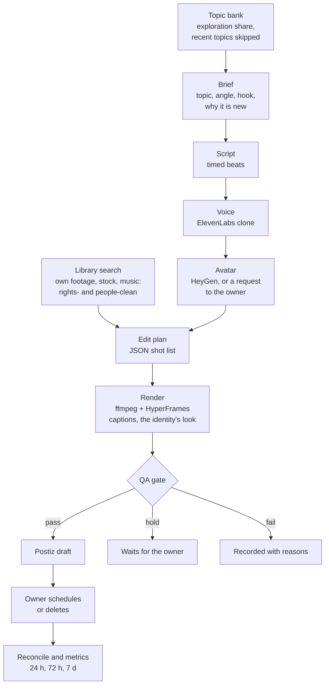
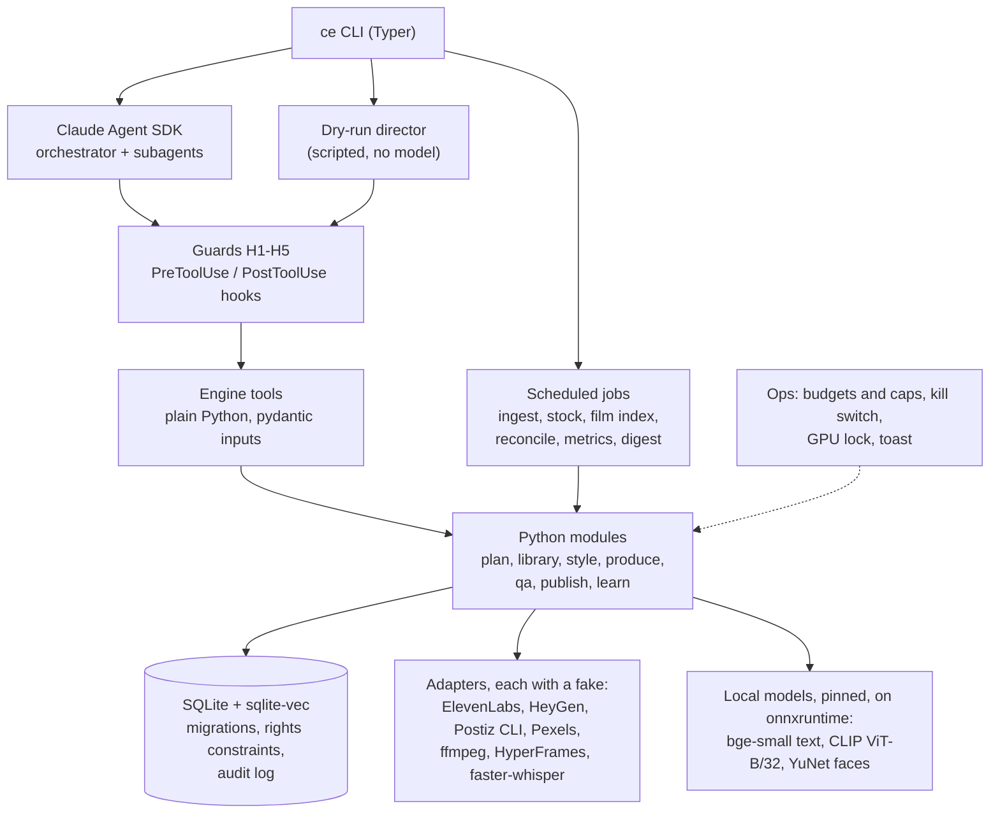

# content-engine

[](https://github.com/digiscalability/content-engine/actions/workflows/ci.yml)

A local Python system that plans, scripts, voices, edits and drafts short vertical videos for niche *identities*, under rules a human sets. Claude makes the judgment calls (the brief, the script, the edit plan, the QA review). Python does everything mechanical and owns every side effect, behind guards the model cannot talk its way past. A person approves every post before it goes out.


*A replay of a real `ce daily --dry-run` on the build machine, from the run's own audit log (timings real, the render sped up). Every vendor is faked, so the presenter is a placeholder card and the B-roll is drawn by ffmpeg.*

**[Watch the walkthrough (MP4, 2:44)](docs/media/walkthrough.mp4).** The engine rendered it with its own HyperFrames setup from that one dry run's database and files: the brief, the script, the edit plan, the Short in full, the QA gate, what happens after the draft, and the guards. Every number on screen comes from the run. It is silent, because the faked voice is.

> **Status:** Phase 1 of the build. Every slice that needs no account or key is done. The pipeline runs end to end on fakes, and so do the footage library, style looks, topic planning, the full QA gate, budgets and a kill switch, the daily jobs and digest, the film-drive index, and metrics reconciliation. The live slices (real voice clone, real avatar, the first published Short) wait on accounts and keys.

## What a post goes through



- **The edit plan is data, not pixels.** Claude submits a validated JSON shot list (source in and out points, speed, freezes, zooms, the voice, the music bed, overlay blocks, captions). The renderer turns it into a 1080×1920 H.264 MP4 at −14 LUFS with metadata stripped, the same way every time.
- **Captions come from the final mix.** Whisper large-v3 transcribes the mixed audio on the GPU, word starts snap to the voice's real speech onsets, and HyperFrames renders the caption layer with alpha.
- **Each identity has a look.** A style analyser measures reference Shorts the owner supplies: cuts a minute, shot length, tempo, caption height and a colour palette (ffmpeg scene cuts and OCR). The references are deleted after measurement; only the numbers stay. A look is versioned YAML with a generated LUT that every render applies. New looks are proposed as three sample renders and the owner approves one.
- **Every render writes a report and two edit exports.** `render_report.json` holds seconds per rights tier, film-excerpt ratios, people flags, loudness and caption coverage. `.otio` and `.fcpxml` let the owner open the edit in DaVinci Resolve and polish it by hand.

## Architecture



- **Agents act only through engine tools.** They have no shell, no web and no file writes. Every tool is plain Python with a pydantic input model, tested without Claude, and the SDK serves them to the agents in-process.
- **One guard table serves both paths.** Each guard decides whether a call may run, and a guard that crashes blocks the call.
  - **H1, publish:** nothing is scheduled at the lowest autonomy level, and holds always wait for the owner.
  - **H2, read:** the agent may read only `config/`, the prompts and the work folder, checked on real paths so junctions, 8.3 short names and data streams don't get around it.
  - **H3, budget:** voice stays under the engine's monthly cap and above the account's floor, avatar credits and renders stay under their caps, and a render needs disk above the stop line.
  - **H4, rights:** an edit plan must be rights-clean before it is stored.
  - **H5, audit:** every call writes a row to the audit log.
- **The agent never sees a vendor key.** The SDK hands its subprocess the parent's whole environment, so every key but Anthropic's is scrubbed before a run, and a test proves it.
- **Money has hard stops.** A run's Claude budget is capped by what is left of the month, and every vendor has a monthly cap with a preflight before any batch. A spent cap stops the work and shows up in the daily digest. `ce kill <identity>` pauses an identity at once, and every kill, warning and resume is a permanent row.

## Footage and rights

- **Footage enters only with a rights record.** Each source in the sources file carries a rights tier (own, stock, CC BY, film reference and so on) with its proof, and the schema forces assets to match their source's tier.
- **Own footage is indexed in place.** Ingest hashes and dedupes each clip, then stores its scenes and keyframes, a transcript, text vectors (bge-small) and keyframe vectors (CLIP) in sqlite-vec, plus a face check. Each step commits on its own, so a run resumes.
- **People need a release.** YuNet checks a frame every second and each keyframe. A clip with any face stays out of search until the owner marks it, and a check that saw no frame fails closed.
- **Search filters before it ranks.** `search_library` drops anything outside the format's tiers, the people rule or a live licence in SQL, then ranks by cosine distance.
- **Stock is fetched only for gaps.** When a beat's best match scores under a threshold measured on the real CLIP, its query is queued, and a nightly job fetches stock clips for that queue alone, capped per day. Each clip lands with its licence record; a stock asset without one is never searchable.
- **Music comes from an imported pool,** with tempo and an energy band matched to the identity's look.
- **Film is evidence, not footage.** Film drives are indexed in place and read-only, resumably, overnight. Film is used only as short credited excerpts in breakdowns, within per-post limits.

## The QA gate

Deterministic checks run first. The qa-reviewer agent judges only a render that passed them all, once, and its verdict is final: a hold never turns into a pass.

| Check | What fails or holds a post |
|---|---|
| Rights | Any shot outside its tier, licence or people rule, re-checked on the rendered plan |
| Disclosure | An avatar or AI-made picture without the AI label, or on a channel with no label route |
| Banned topics | Health, money, legal, political or religious claims (whole-word screen; the reviewer judges meaning) |
| Claims about the presenter | First person, anything on the presenter's never list, or a role, place or number the public fact sheet doesn't hold |
| Self-dedupe | A voiced script too close to one of the identity's last 50 posts (bge-small embeddings) |
| Platform spec | Resolution, frame rate, duration, loudness, caption coverage, and the measured caption box outside a platform's safe zone |
| Reviewer | A verdict without its checklist: a pass needs at least two things the post adds and a fit with the identity |

The never list and the fact sheet are read at run time from a file outside the repo, so no personal facts are copied into it.

## Running it every day

- **Jobs:** PowerShell wrappers run the daily pass, the nightly ingest and stock fetch, the film index and the metrics pull, with logs and one GPU job at a time (a file lock across processes). Registering them in Task Scheduler is a dry run until the owner says yes.
- **Digest:** each morning the engine writes the day's digest from the database. A Windows notification appears when anything waits on the owner, and clicking it opens the digest.
- **After the draft:** `ce reconcile` follows each draft through Postiz to scheduled, published, rejected or failed, and `ce metrics` takes snapshots at 24 h, 72 h and 7 days. The dry run plays the owner and runs both on fakes.

## How it is tested

```text
uv run pytest            # unit and contract tests on fakes: no network, no GPU, no keys
uv run pytest -m golden  # real ffmpeg (NVENC) and HyperFrames renders
uv run pytest -m model   # the real local models: bge-small, CLIP ViT-B/32, YuNet
uv run pytest -m gpu -s  # Whisper large-v3 on the GPU against a recorded fixture
uv run ruff check . && uv run ruff format --check .
```

- **Fakes everywhere outside the process.** Each external service sits behind a protocol with a fake. A contract test runs the real adapter and its fake through the same cases: HeyGen against a mocked v3 API and the drop-folder route, Pexels over a mock transport, Postiz through its CLI's JSON.
- **Golden renders are checked by measurement.** Duration, codec and frame count, loudness, ducking depth, frozen frames, the colour grade, and overlays composited after it; frame hashes catch drift.
- **The dry run is an end-to-end test.** `ce daily --dry-run` takes a post from brief to a fake Postiz draft through the real tools, guards and audit log, in a throwaway database, then reconciles it to published. The golden suite opens both exports and follows the post's state.
- **Guards are tested by breaking them.** Key guards (the licence and people filters, the kill-switch filter, the daily caps, the hash cache and more) were each disabled on purpose once, and their tests had to go red.
- **CI on every push.** GitHub Actions on Windows runs ruff and every test that needs no keys, GPU, models, ffmpeg or network. Tests that need ffmpeg carry a `media` marker, and a tripwire fails any test that reaches the network. The actions are pinned to commits. [ADR 0024](docs/adr/0024-ci-and-walkthrough.md) has the details.
- **Secret scanning.** A pre-commit hook blocks key-shaped strings and secret-bearing file types. `scripts/check_secrets.py --history` scans every blob in the history.

## Run it

Windows 11, Python 3.11 with [uv](https://docs.astral.sh/uv/), ffmpeg and ffprobe on PATH, Node 22+. An NVIDIA GPU with NVENC for renders.

```powershell
uv sync
git config core.hooksPath .githooks   # pre-commit secret scan
uv run ce doctor                      # tools, GPU, disk, config, models, and which keys are set
uv run ce daily --dry-run             # one sample post per identity, every vendor faked
uv run python scripts/make_demo.py    # re-render the walkthrough from the newest dry run
```

Keys go in `.env`, copied from `.env.example`. `ce doctor` reports each one as set or missing and never prints a value.

## Layout

| Path | What |
|---|---|
| `engine/agents/` | Tools, guards (hooks), agent definitions, SDK options, the dry-run director |
| `engine/config/` | Config models and loader: engine settings, rights-recorded sources, identities |
| `engine/plan/` | Playbook loader and topic planning |
| `engine/library/` | Footage library: ingest, scenes and keyframes, transcripts, embeddings in sqlite-vec, the face check and people rule, search, stock, music, the film-drive index |
| `engine/style/` | Style analyser (scene cuts, OCR, tempo, palette) and looks |
| `engine/produce/` | Edit plan, ffmpeg renderer, captions, HyperFrames overlays, voice and avatar adapters, render report, OTIO and FCPXML exports |
| `engine/qa/` | Rights and disclosure, text, self-dedupe and platform-spec checks |
| `engine/publish/` | Postiz CLI adapter and its fake, YouTube visibility |
| `engine/learn/` | Reconciliation and metrics snapshots |
| `engine/ops/` | Budgets and caps, kill switch, GPU lock, daily digest, Windows notification |
| `engine/db/` | SQLite connection and numbered migrations |
| `engine/prompts/` | Agent prompts, passed as files |
| `config/` | Engine settings, rights-recorded sources, identities and their playbooks |
| `hyperframes/` | Caption composition templates |
| `scripts/` | Job wrappers, secret scan, the walkthrough and fixture makers, the public-mirror builder |
| `tests/` | Unit, contract, golden, model and GPU tests; generated fixtures only, never real footage |
| `.github/workflows/` | CI |
| `docs/adr/` | [Architecture decision records](docs/adr/README.md): one per choice, with its reasons |

Requirement ids in the code and the ADRs (FR-…, GR-…, NFR-…) point to the project's private requirements document. The ADRs carry each decision and the reasons for it.

---

Built by [Abbas Ali](https://www.linkedin.com/in/-abbas-ali), with Claude Code as pair programmer. [MIT licence](LICENSE).
